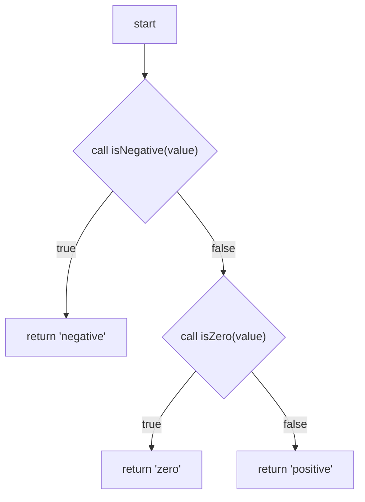

# Seawitch

Seawitch compiles a Mermaid flowchart into a TypeScript function. The `.sea.mmd` file is the source of the function: the same text renders in ordinary Mermaid and compiles to TypeScript. Generated code calls ordinary TypeScript functions and other Seawitch functions. There is no Seawitch runtime.

A flowchart expresses control flow only: calls, boolean decisions, and returns. Other computation stays in TypeScript.

The language rules are in [language-specification.md](language-specification.md). This repository is the v0.1 compiler.

## Example

`examples/classifyNumber/classifyNumber.sea.mmd`:



`isNegative` and `isZero` are TypeScript functions. `describeNumber.sea.mmd` calls `classifyNumber` the same way. `examples/order/fulfillOrder.sea.mmd` is a larger function: a typed input, intermediate results, a decision, a join, and a typed result.

## Compile

Requires Node.js 22 or newer.

```sh
npm install
npm run seawitch -- compile \
  examples/classifyNumber/classifyNumber.sea.mmd \
  examples/classifyNumber/describeNumber.sea.mmd \
  --src examples/classifyNumber \
  --out generated
```

```text
seawitch compile <files.sea.mmd...> --src <root> --out <dir>
```

`--src` is the root of the Seawitch sources. `--out` mirrors that layout and writes one `.ts` file per flowchart. The compiler rewrites imports from the generated file back to the original TypeScript modules, and from a `.sea.mmd` import to the generated sibling. It writes a file only when the bytes change. Diagnostics go to stderr and look like `SW104 classifyNumber.sea.mmd:8 [zero]: Decision is missing a 'false' outgoing edge.`

`classifyNumber` compiles to:

```ts
export function classifyNumber(value: number): Classification {
  if (isNegative(value)) {
    return 'negative';
  } else {
    if (isZero(value)) {
      return 'zero';
    } else {
      return 'positive';
    }
  }
}
```

When both arms of a decision reach the same continuation, that continuation is emitted once after the `if` / `else`. A value is available at a node only when the node that produced it dominates the use. A branch-local result cannot be read after the branches converge.

## Tests

```sh
npm test
```

The suite compiles the examples, runs the generated functions, checks diagnostics, and renders the unchanged `.sea.mmd` sources with Mermaid 12.2.0. `npx tsc --noEmit` typechecks the compiler. GitHub Actions runs `npm test` on Node 22.

## What a flowchart can say

One function per file. The signature and imports are `%% seawitch:` comments, so Mermaid ignores them. Imports are relative `import { ... } from "./mod.js"` and `import type { ... } from "./mod.js"`.

A call node is `id["call helper(arg, ...)"]`. A decision is `id{"call predicate(arg)"}` with `-->|true|` and `-->|false|` edges. A return is `id["return value"]`. Arguments are parameters, earlier node ids, and literals.

The flowchart is acyclic. Every path reaches a return. Decisions must return a real boolean. Generics, overloads, rest parameters, and `Promise` results are rejected at the boundary; wrap those in a normal TypeScript function.

Loops, recursion, assignments, and other expression syntax are outside the language. Some acyclic graphs are not a single join: a node reached by crossing branches is copied into each path in the generated TypeScript, and only the taken copy runs. Section 13.7 of the specification describes that case and the `SW103` size guard.
