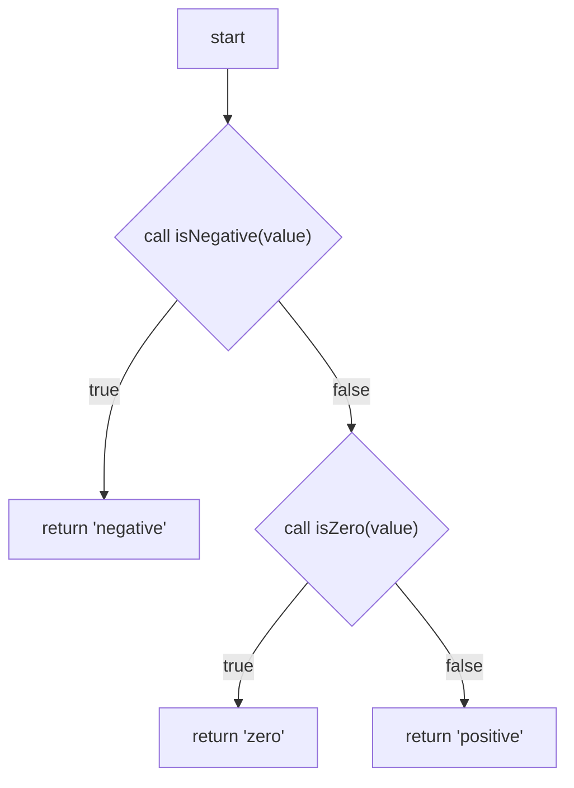

# Seawitch

Seawitch compiles a Mermaid flowchart into a TypeScript function. The `.sea.mmd` file is the source of the function: the same text renders in ordinary Mermaid and compiles to TypeScript. Generated code calls ordinary TypeScript functions and other Seawitch functions. There is no Seawitch runtime.

A flowchart expresses control flow: boolean decisions, expressions, calls, and returns. Assignments, loops, and other statements stay in TypeScript.

The language rules are in [language-specification.md](language-specification.md). This repository is the v0.1 compiler.

## Example

`examples/classifyNumber/classifyNumber.sea.mmd`:



`isNegative` and `isZero` are TypeScript functions. `describeNumber.sea.mmd` calls `classifyNumber` the same way. `examples/order/fulfillOrder.sea.mmd` is a larger function: a typed input, intermediate results, a decision, a join, and a typed result.

## Compile

Requires Node.js 22 or newer.

```sh
npm install
npm run seawitch -- compile \
  examples/classifyNumber/classifyNumber.sea.mmd \
  examples/classifyNumber/describeNumber.sea.mmd \
  --src examples/classifyNumber \
  --out generated
```

```text
seawitch compile <files.sea.mmd...> --src <root> --out <dir>
```

`--src` is the root of the Seawitch sources. `--out` mirrors that layout and writes one `.ts` file per flowchart. The compiler rewrites imports from the generated file back to the original TypeScript modules, and from a `.sea.mmd` import to the generated sibling. It writes a file only when the bytes change. Diagnostics go to stderr and look like `SW104 classifyNumber.sea.mmd:8 [zero]: Decision is missing a 'false' outgoing edge.`

`classifyNumber` compiles to:

```ts
export function classifyNumber(value: number): Classification {
  if (isNegative(value)) {
    return 'negative';
  } else {
    if (isZero(value)) {
      return 'zero';
    } else {
      return 'positive';
    }
  }
}
```

When both arms of a decision reach the same continuation, that continuation is emitted once after the `if` / `else`. A value is available at a node only when the node that produced it dominates the use. A branch-local result cannot be read after the branches converge.

## Tests

```sh
npm test
```

The suite compiles the examples, runs the generated functions, checks diagnostics, and renders the unchanged `.sea.mmd` sources with Mermaid 12.2.0. `npx tsc --noEmit` typechecks the compiler. GitHub Actions runs `npm test` on Node 22.

## What a flowchart can say

One function per file. The signature and imports are `%% seawitch:` comments, so Mermaid ignores them. Imports are relative `import { ... } from "./mod.js"` and `import type { ... } from "./mod.js"`.

A decision is `id{"expression"}` with `-->|true|` and `-->|false|` edges. A computation is `id["expression"]`, and its result is available under that id. A return is `id["return expression"]`. The label is the code that runs. The expression subset allows property reads, calls, `!`, comparisons with `===` and `!==`, and `&&` / `||`. Calls in that subset may have side effects. `==`, `!=`, assignments, and ternary expressions are rejected.

`id["call helper(arg, ...)"]` and `id{"call predicate(arg)"}` still compile. New graphs should write `helper(arg)` in the label instead. Arguments in the `call` form are parameters, earlier node ids, and literals. Section 13.9 of the specification is the expression subset.

The flowchart is acyclic. Every path reaches a return. Decisions must be a real boolean. Generics, overloads, rest parameters, and `Promise` results are rejected at the boundary; wrap those in a normal TypeScript function.

Loops, recursion, and assignments stay outside the language. Some acyclic graphs are not a single join: a node reached by crossing branches is copied into each path in the generated TypeScript, and only the taken copy runs. Section 13.7 of the specification describes that case and the `SW103` size guard.

## Reader view

`seawitch render <files.sea.mmd...> --out <dir>` writes a plain `.mmd` flowchart for each source file. That file is ordinary Mermaid. It is not Seawitch source, and `seawitch compile` rejects it. The `.sea.mmd` file remains the only executable source. Vocabulary changes the reader view and does not change the generated TypeScript.

```text
%% seawitch: vocabulary ctx.risk = risk
%% seawitch: vocabulary 'unknown_timing' = unknown timing
%% seawitch: vocabulary ctx.pep_window['unknown_timing'] = unknown
%% seawitch: vocabulary "./risk-vocabulary.json"
```

A shared file is a JSON object of those keys. `ctx.risk === 'high' || ctx.risk === 'moderate'` becomes `risk is high or moderate`. `subject['literal']` changes that literal only in a comparison with that subject, and the global literal phrase remains the fallback. `ctx.pep_window === 'unknown_timing'` can read `PEP timing is unknown` while `strength === 'unknown_timing'` still reads `strength is unknown timing`. Three or more equalities on the same safe subject use an Oxford comma: `risk is high, moderate, or low`. Calls are not folded together. A comparison the plain-language rules do not cover stays in source form. The generated file starts with `%% Generated by Seawitch. Do not edit.` and contains no `%% seawitch:` lines. Section 14 of the specification is the full presentation rule. A phrase is whatever the mapping says. The compiler does not judge whether that wording is clinically right.

A Boolean decision that is only a direct call can become a question when the function name follows one of two patterns. `actIsExcludedFromRoutineHivPep` reads `Is the act excluded from routine HIV PEP?`. `veryLowRiskExcludesRoutineHivPepBeforeWindow` reads `Does very low risk exclude routine HIV PEP before the window?`. The verb token must be `Excludes`, `Overrides`, `Supports`, `Requires`, `Allows`, or `Replaces`, and the question uses the base verb after `Does`. Vocabulary entries such as `act`, `veryLowRisk`, `routineHivPep`, and `beforeWindow` supply the noun phrases, including articles and acronyms. They do not map the whole function to a sentence. The type checker must already see a plain boolean return. A computation, a return, a method, a larger Boolean expression, and any other name stay in source form. The question follows the name, not the function body. Section 14 states the patterns and the fallbacks.
