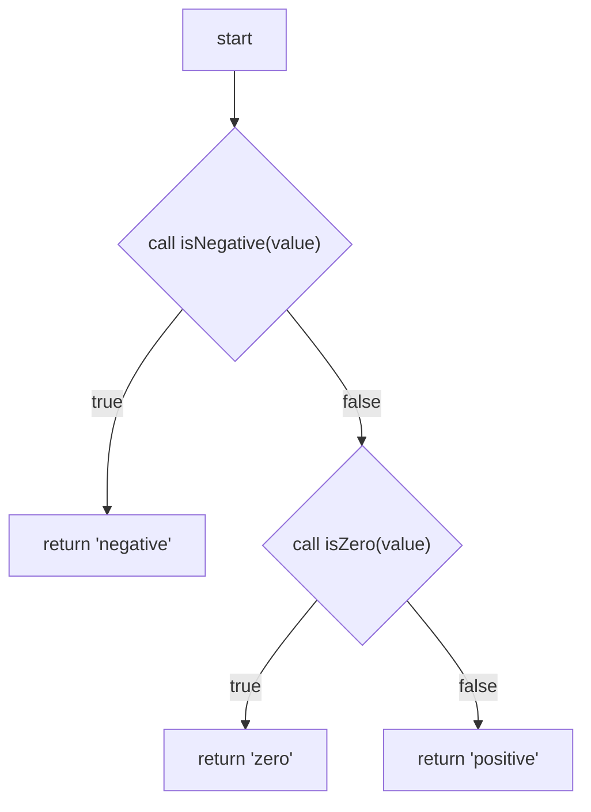
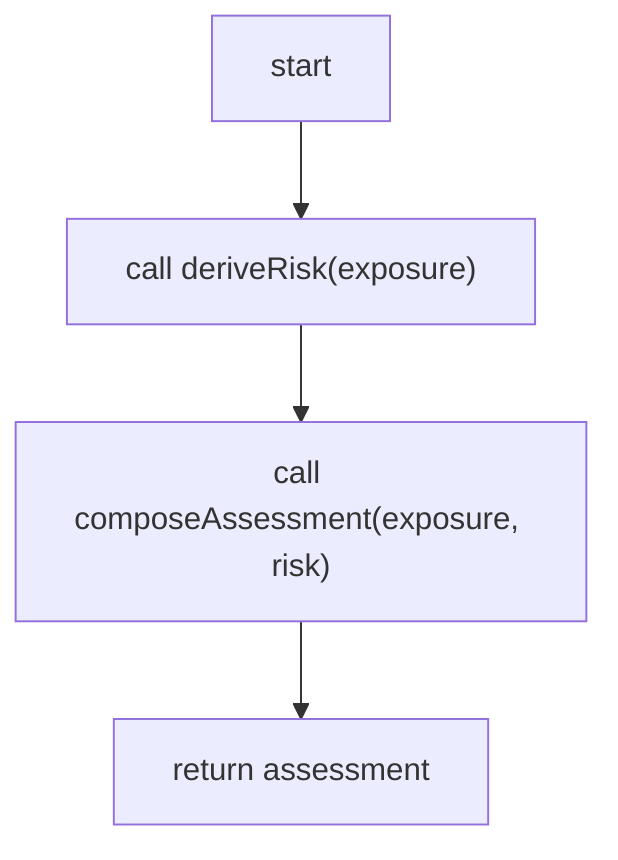

# Seawitch Language Specification

**Version:** 0.1.0-draft  
**Status:** Proposed design; not yet implemented or validated by a prototype  
**Date:** 2026-10-24

## 1. Purpose

Seawitch defines executable functions using a constrained subset of **ordinary Mermaid flowchart syntax**. A Seawitch compiler validates each graph and transpiles it into a TypeScript function. A Seawitch function may invoke other Seawitch functions or ordinary TypeScript functions. Both kinds of functions have TypeScript-compatible signatures.

**Principle:** Express only the control flow that is clearer as a flowchart. Delegate any other computation to TypeScript. Mermaid is the canonical source for a Seawitch function's behavior, not a diagram copied from an independent implementation.

This document specifies the proposed first release. Its examples are intended to render in a standard Mermaid flowchart renderer; compatibility still needs to be demonstrated through conformance tests against a pinned Mermaid version.

### 1.1 Normative terminology

**MUST**, **MUST NOT**, **SHOULD**, and **MAY** specify requirements and recommendations for a conforming implementation. Sections labeled *design rationale* or *deferred* are informative.

### 1.2 Goals

- Text-first authoring in a conventional editor; readable Git diffs.
- Direct rendering of the same source as a Mermaid flowchart.
- Explicit, statically checkable control flow and TypeScript-compatible types.
- First-class calls to ordinary TypeScript and other Seawitch functions.
- Generated TypeScript requiring no Seawitch runtime interpreter.
- Clear, source-located diagnostics for invalid programs.
- Minimal language surface: **calls, binary decisions, returns**.

### 1.3 Non-goals

- Replacing TypeScript or its ecosystem.
- Native loops, recursion, assignments, operators, arrays, object constructors, pattern matching, exceptions, asynchronous execution, or mutable variables.
- A drag-and-drop editor or graphical source-of-truth format.
- Arbitrary Mermaid diagrams becoming executable automatically.
- Automatic proof of the clinical or domain correctness of a rule.

## 2. Fundamental model

Each `*.sea.mmd` file defines **exactly one function** with:

1. A name, zero or more **typed** inputs, and exactly one **typed** output.
2. One entry node.
3. Zero or more **call nodes**, each invoking a named function.
4. Zero or more **decision nodes**, each invoking a function that returns `boolean`.
5. One or more **return nodes**.

The flowchart describes the **order of execution**, not dataflow. Outputs of function calls are immutable values bound to their node identifiers. Calls are performed only when execution reaches their node. Every execution path MUST eventually reach a return node, assuming called functions terminate and do not throw.

A call may target an ordinary TypeScript function or a Seawitch function. The calling syntax and typing rules are the same.

## 3. File format and declarations

### 3.1 File extension

A Seawitch source file MUST end in `.sea.mmd`. The file MUST contain one standard Mermaid `flowchart` declaration with direction `TD`, `TB`, `LR`, `RL`, or `BT`.

### 3.2 Directives

Declarations are placed in valid Mermaid **whole-line comments** after `flowchart`:



The `%% seawitch:` lines MUST be ignored by ordinary Mermaid rendering and interpreted by the Seawitch compiler. The compiler MUST reject unknown `seawitch:` directives; unrelated ordinary Mermaid comments are ignored.

In v0.1:

- `function <name>(<name>: <type>, ...): <returnType>` declares the one exported function. The signature is required, including an explicit return type.
- `import { <symbols> } from "<module>"` imports callable runtime symbols.
- `import type { <symbols> } from "<module>"` imports type names.
- Imports MUST use statically written relative module paths. Bare package specifiers and wildcard imports are deferred.
- Imports from `.sea.mmd` resolve to generated Seawitch TypeScript modules; imports from ordinary `.js` module specifiers use TypeScript's normal source-to-output module resolution.
- Types are TypeScript type annotations, validated by the TypeScript checker. The v0.1 compiler need not implement an independent type language.

No instruction-bearing syntax is added outside valid Mermaid comments and quoted node labels.

### 3.3 Required example dependencies

The example above assumes these ordinary TypeScript declarations:

```ts
// types.ts
export type Classification = 'negative' | 'zero' | 'positive';

// predicates.ts
export function isNegative(value: number): boolean {
  return value < 0;
}
export function isZero(value: number): boolean {
  return value === 0;
}
```

The example compiles conceptually to:

```ts
import type { Classification } from './types.js';
import { isNegative, isZero } from './predicates.js';

export function classifyNumber(value: number): Classification {
  if (isNegative(value)) return 'negative';
  if (isZero(value)) return 'zero';
  return 'positive';
}
```

This is a semantic equivalence illustration. Generated formatting and variable names need not be identical.

## 4. Executable node types

A conforming compiler recognizes the following **node IDs, shapes, and exact label prefixes**. IDs MUST be valid TypeScript identifier tokens and MUST be unique within the graph; they MUST NOT collide with parameter or imported symbol names.

| Node | Mermaid shape | Required label | Behavior |
| --- | --- | --- | --- |
| Entry | Rectangle | `start` | Begins function evaluation; ID MUST be `start` |
| Call | Rectangle | `call functionName(arg1, arg2)` | Calls function, binds output to the node ID, follows its one successor |
| Decision | Diamond | `call predicateName(arg1, arg2)` | Calls Boolean function; follows exactly one `true` or `false` edge |
| Return | Rectangle | `return value` | Returns literal, parameter, or available node result; no successor |

Node IDs, shapes, and executable labels carry semantics; visual style, graph direction, and layout do not. The entry node MUST be a rectangle named `start` with label `start` and no incoming edges. It MUST have exactly one outgoing edge unless it is the only executable node in an explicitly supported future extension; v0.1 does not permit such empty functions.

A call node MUST have exactly one outgoing edge. A decision node MUST have exactly two outgoing edges, with labels **exactly** `true` and `false`; either may point to the same target node. Return nodes MUST have no outgoing edges.

Executable nodes MUST be connected to the entry. An unsupported shape, label, edge format, or disconnected executable node is a compile-time error. Subgraphs, click handlers, hyperlinks, and Mermaid's other executable-looking features do not acquire Seawitch meaning in v0.1.

## 5. Arguments, values, and types

### 5.1 Argument grammar

Each call supplies a comma-separated list of arguments in the same order as the callee's signature. An argument is one of:

- A function parameter identifier.
- The node ID of a previously evaluated call or decision.
- A primitive literal: a single-quoted string, decimal number, `true`, `false`, or `null`.

**Not** valid v0.1 arguments: arbitrary expressions such as `a + b`, property access such as `exposure.date`, object/array literals, method calls, lambdas, or conditional expressions. Write a TypeScript helper function for these operations instead.

A return node uses the same single-value grammar. Its value MUST be assignable to the function's declared output type. Return nodes do not call functions implicitly.

### 5.2 Node results and control-flow merges

For a call or decision node `risk`, the name `risk` denotes that node's returned value.

A graph MAY have converging paths. However, a node result may be referenced only if its producing node is guaranteed to have been executed **on every path** reaching the reference (*dominance rule*). This prevents reading values defined only on one branch. Parameters and literals are available on all paths.

For v0.1, when branches compute different values intended as a common output, the preferred pattern is to return separately from each branch or to move the computation into a helper function. No `phi` nodes or mutable assignments are required.

### 5.3 Type checking

The compiler MUST check:

- Imported functions and types resolve.
- Function calls have valid argument counts and compatible parameter types.
- Decision calls return a type assignable to primitive `boolean`. `any`, `unknown`, nullable unions (`null` or `undefined` in the type), and non-boolean types are rejected. A type alias of `boolean` is accepted. The literal type `true` is accepted because it is assignable to `boolean`. Truthy or falsy values of other types are not.
- Node references satisfy the dominance rule.
- Every return value is compatible with the declared return type.
- A call to another Seawitch function is checked by the same rules as a call to a TypeScript function.

Overloads, generic function declarations, rest parameters, and asynchronous/Promise-returning calls are **outside the required v0.1 subset**. They can be used behind monomorphic, synchronous TypeScript adapter functions.

## 6. Execution semantics

1. The generated function receives its arguments, then starts at the entry node.
2. Upon reaching a call node, evaluate its arguments as already available values, call the named function **once**, bind the result to that node ID, and continue to the sole successor.
3. Upon reaching a decision node, call its named Boolean function **once**, then follow the matching labeled edge.
4. Upon reaching a return node, evaluate its single operand and immediately return it.
5. Nodes not on the selected execution path MUST NOT execute.
6. If a called function throws, the exception propagates normally to the caller; v0.1 adds no catch/finally semantics.

The compiler MUST preserve observable call ordering and must not speculatively evaluate unchosen branches. TypeScript functions MAY have side effects; Seawitch itself adds no hidden side effects. Pure helper functions are recommended, not required.

### 6.1 Termination constraints

V0.1 graph edges MUST be acyclic. Seawitch-to-Seawitch function references MUST also be acyclic; direct and indirect graph recursion are rejected.

The compiler MUST reject graphs with a reachable path that fails to terminate at a return node. These constraints guarantee termination of the **graph's own control flow**, conditional on external TypeScript calls terminating; they do not imply arbitrary imported TypeScript code cannot loop, recurse, or throw.

## 7. Graph composition example

A composed function can call other Seawitch functions or TypeScript functions without differentiating them in its graph:



Here `deriveRisk` is Seawitch-defined and `composeAssessment` is TypeScript-defined. Their implementation languages do not change the calling contract. `deriveRisk` must be exported under that name from its own one-function `.sea.mmd` file.

## 8. Compiler contract

### 8.1 Required stages

A conforming compiler MUST:

1. Read and validate the file as Mermaid flowchart syntax against a **documented, pinned Mermaid version**.
2. Parse only the explicit Seawitch subset and extract directives, nodes, and edges. It MUST NOT infer executable behavior from arbitrary prose labels.
3. Construct a typed intermediate representation of the control-flow graph.
4. Resolve imports and build the graph-to-graph dependency graph.
5. Verify shape, graph structure, branch completeness, acyclicity, reachability, dominance, and return completeness.
6. Check signatures, return types, and invocation types using TypeScript-compatible resolution.
7. Emit ordinary `.ts` source corresponding to each Seawitch function, with deterministic output from a given input and configuration.
8. Emit source-located errors that mention the Mermaid filename and relevant line and node where possible.

The compiler MAY use Mermaid's tooling for rendering/syntax checking and its own parser for the stricter executable subset. Merely passing Mermaid parsing does **not** constitute Seawitch validity.

### 8.2 Output and integration

Given `src/assessExposure.sea.mmd`, the default compiler layout SHOULD generate `generated/assessExposure.ts`, maintaining source-relative directory structure. Imports of sibling Seawitch graphs are rewritten to corresponding generated TypeScript module paths. Ordinary TypeScript imports MUST be rewritten as necessary to continue resolving to the **same original module** when output files live in a different directory; preserving a relative import string verbatim is not sufficient if it changes its target.

The generated module exports the declared function name. It must compile under a documented supported TypeScript version. No extra runtime engine, graph interpreter, browser APIs, React, or clinical library is required.

The compiler SHOULD avoid changing generated files when source output is unchanged. Generated files SHOULD be clearly marked as generated and not manually edited.

### 8.3 Errors

A valid diagnostic includes an error category, human-readable explanation, source file, and preferably source span/node ID. Compilation MUST fail on invalid graph semantics rather than silently inventing branches, return values, or default behavior.

Examples:

```text
SW104 assessExposure.sea.mmd:14 [withinWindow]:
Decision is missing a 'false' outgoing edge.

SW203 assessExposure.sea.mmd:20 [recommend]:
Argument 'risk' may not be defined on all incoming paths.

SW301 assessExposure.sea.mmd:11 [isEligible]:
Decision call must return boolean; actual return type is RiskTier.
```

The codes above are proposed examples, not an implemented diagnostic registry.

## 9. Minimum conformance suite

An implementation of v0.1 MUST include automated positive and negative tests for the following cases:

| # | Test | Expected |
| --- | --- | --- |
| 1 | One function with an ordinary TS helper and return | Correct compiled value |
| 2 | A binary decision with distinct return leaves | Correct true/false behavior |
| 3 | A TypeScript helper returning a typed object | Typed output preserved |
| 4 | One Seawitch graph calling another | Correct runtime behavior and imports |
| 5 | Nested decisions | Correct output on all paths |
| 6 | A call on an unchosen branch | That call is not executed |
| 7 | Missing true or false branch | Compile-time error |
| 8 | Invalid Boolean predicate return type | Compile-time error |
| 9 | Referencing a branch-local value after a merge | Compile-time error |
| 10 | Cycle inside a flowchart | Compile-time error |
| 11 | Circular dependency between Seawitch functions | Compile-time error |
| 12 | Reachable path without a return | Compile-time error |
| 13 | Wrong number/type of function arguments | Compile-time error |
| 14 | Missing import or unknown called function | Compile-time error |
| 15 | Invalid Mermaid syntax | Render/parse error before code generation |
| 16 | Valid Seawitch graph | Diagram renders in pinned stock Mermaid |
| 17 | A TypeScript function calling generated Seawitch code | Works with standard TS imports |
| 18 | Same inputs compiled twice | Identical emitted source |

Both Mermaid rendering tests and generated TypeScript execution tests SHOULD be included in continuous integration.

## 10. First implementation milestone (not the full product)

The first prototype SHOULD implement only this vertical slice:

- Compile the `classifyNumber.sea.mmd` example.
- Render its original `.sea.mmd` as a Mermaid diagram without preprocessing.
- Produce type-checked TypeScript that passes the three negative/zero/positive tests.
- Diagnose a missing decision edge and an incorrect return type.
- Demonstrate one Seawitch graph calling another.

**Success criterion:** the same `.sea.mmd` source is simultaneously readable Mermaid and an executable, type-checked TypeScript function specification, with no manually synchronized diagram or implementation.

Only after this milestone should the team attempt a production WhatNext.Health decision channel or an entire assessment slice.

## 11. Proposed decisions awaiting prototype feedback

The following are specified provisionally for v0.1 but should be evaluated through implementation rather than accepted as permanently optimal:

1. **Metadata in `%% seawitch:` comments.** Preserves stock Mermaid compatibility while keeping signature and imports with the diagram.
2. **Meaning in node labels.** Keeps authoring terse, but requires robust parsing of quoted text. An alternate syntax could use metadata comments keyed by node ID.
3. **No branch-merge value selection.** Separate returns and helper calls keep the semantics small; real examples may justify a narrowly scoped merge construct later.
4. **Strict synchronous and acyclic graph subset.** Easy to validate, but intentionally does not address every possible algorithm.
5. **Dependency resolution through explicit imports.** Keeps name resolution deterministic and aligns with ordinary TypeScript conventions.

These are design choices for testing, **not evidence that the compiler has already been implemented**.

## 12. Deferred capabilities

Explicitly out of scope for v0.1: loops, recursion, async/await, native expression evaluation, arbitrary assignments, structured literals, exception handling, visual editing, automatic graph extraction from existing TypeScript, automatic clinical claim tracking, integrated execution tracing, and UI frameworks. They can be proposed individually if real code examples demonstrate enough value.

## 13. Prototype decisions

These decisions are normative for the Milestone 1 prototype. They narrow the draft above where it was ambiguous. They do not add loops, recursion, a visual editor, or a Seawitch runtime.

### 13.1 Flowchart subset

A v0.1 source file is one statement per line. A trailing semicolon is optional. The header direction is `TD`, `TB`, `LR`, `RL`, or `BT`. The only links are `-->`, `-->|true|`, and `-->|false|`. Executable node labels are double-quoted. The entry node `start` has exactly one unlabeled outgoing edge.

The following are compile errors: YAML front matter, chained edges, `&` forks, subgraphs, `click` and `href` statements, and `@{ }` shape syntax. Ordinary `%%` comments are ignored. Unknown `%% seawitch:` directives are errors.

### 13.2 Declarations

A file has exactly one `function` directive. Imports are only:

- `import { A, B } from "./mod.js"`
- `import type { A, B } from "./mod.js"`

Specifiers are relative. Aliases, wildcards, and default imports are rejected. A `.sea.mmd` import's local name must be that file's declared function. A Seawitch module exports only that function.

The compiler parses `function` and `import` directives with the TypeScript parser (`ts.createSourceFile` on the directive text). It does not implement a second TypeScript grammar. Type text is copied from the TypeScript AST and checked by TypeScript **5.9.3**.

### 13.3 Identifiers and literals

Identifiers are non-reserved TypeScript identifiers. They are not Mermaid statement keywords: `end`, `subgraph`, `graph`, `flowchart`, `click`, `call`, `href`, `style`, `class`, `classDef`, `default`, `linkStyle`, `direction`, `interpolate`. They must not collide with the function name, parameters, imports, or other node ids.

Literals are `true`, `false`, `null`, single-quoted strings with `\\` and `\'` escapes, and optional-minus decimal numbers such as `-1` and `1.5`. `undefined` is not a literal.

A value reference is a parameter, or the id of a call or decision node that strictly dominates the use. Decision nodes bind their boolean result. The entry and return nodes do not produce referenceable values.

### 13.4 Decision types

A decision callee is accepted when its return type is assignable to primitive `boolean` and is not `any`, `unknown`, a nullable union (`null` or `undefined` in the type), or a non-boolean type. A type alias of `boolean` is accepted. The literal type `true` is accepted.

Generic functions, overloads, rest parameters, and `Promise`-returning callees are rejected. Wrap them in a monomorphic synchronous TypeScript adapter.

### 13.5 Mermaid compatibility

The same unmodified `.sea.mmd` bytes must render in a pinned Mermaid release. That render is a conformance test. The compiler does not render diagrams and does not load a DOM. Invalid subset syntax is a Seawitch diagnostic.

The Milestone 1 conformance render uses Mermaid **12.2.0**.

### 13.6 Diagnostics

A diagnostic has the form `CODE file:line [nodeId]: message`. The node id is omitted when the error is not tied to a node. Initial codes:

- `SW010`–`SW015`: syntax and declarations.
- `SW101`–`SW109`: graph structure. `SW104` is a missing `true` or `false` edge. `SW108` is a cycle in the flowchart. `SW103` means structured emission still had to duplicate a region and stopped after 2,000 nodes.
- `SW203`: a reference that does not dominate the use.
- `SW301`: a decision return type that fails the boolean rule.
- `SW302`: a return value not assignable to the declared return type.
- `SW303`: an argument count or type mismatch.
- `SW304`: a generic, overloaded, rest, or asynchronous callee.
- `SW401`–`SW404`: imports and cycles between Seawitch files.

There is no compiler-stage Mermaid or DOM failure code. A file that is not in the supported subset fails with a syntax diagnostic. Rendering failures are reported by the conformance test.

### 13.7 Code generation for joins

The emitter computes immediate postdominators on the flowchart, with a synthetic exit after every return. For a decision, the nodes that appear on only one side are emitted inside `if` / `else`. The immediate postdominator is emitted once after the conditional. A decision whose true and false edges already target that postdominator emits the predicate call and then the continuation, with no empty conditional. Sequential diamonds and diamonds nested inside one arm therefore grow linearly. Call order and side effects follow the taken path.

Some acyclic graphs have no single continuation for a decision. The smallest case is two decisions that cross into the same pair of successors: the true arm of the outer decision reaches one successor, and the inner decision reaches both. Neither successor postdominates the outer decision, so each successor is emitted on every path that reaches it. Only the taken copy runs. That duplication is the fallback. It is not a branch-merge value and it does not relax dominance.

If that fallback would emit more than 2,000 nodes, compilation stops with `SW103` and writes nothing. A cascade of crossing decisions can reach that guard from a small diagram. Ordinary sequential and nested diamonds do not. The guard is a prototype limit on duplicated regions, not a limit on graphs the language accepts.

### 13.8 Converging example

`examples/order/fulfillOrder.sea.mmd` is a non-clinical function with a structured input, intermediate call results, a boolean decision, a converging path, and a structured output. The shared call may use values that dominate the join, including the decision's boolean result. A branch-local result is not a legal argument to that shared call. The source remains ordinary Mermaid. The generated function emits the shared call once, after the conditional.

---

## Appendix A. Minimal syntax summary

```text
file:         <name>.sea.mmd
header:       flowchart TD|TB|LR|RL|BT
signature:    %% seawitch: function name(arg: Type, ...): ReturnType
import:       %% seawitch: import { symbol } from "./module.js"
type import:  %% seawitch: import type { Type } from "./types.js"
entry:        start["start"]
call:         node["call helper(arg, ...)"]
decision:     node{"call predicate(arg, ...)"}
true edge:    decision -->|true| target
false edge:   decision -->|false| target
return:       node["return value"]
```

All these declarations are interpreted only where the full source also satisfies the supported Mermaid flowchart subset. This appendix is a summary, not a separate grammar.

## Appendix B. Design philosophy

**Seawitch is not intended to make everything graphical.** It makes it possible to choose a flowchart wherever a flowchart improves clarity, while retaining TypeScript for all remaining work. The developer, not the language designer, chooses the boundary.
